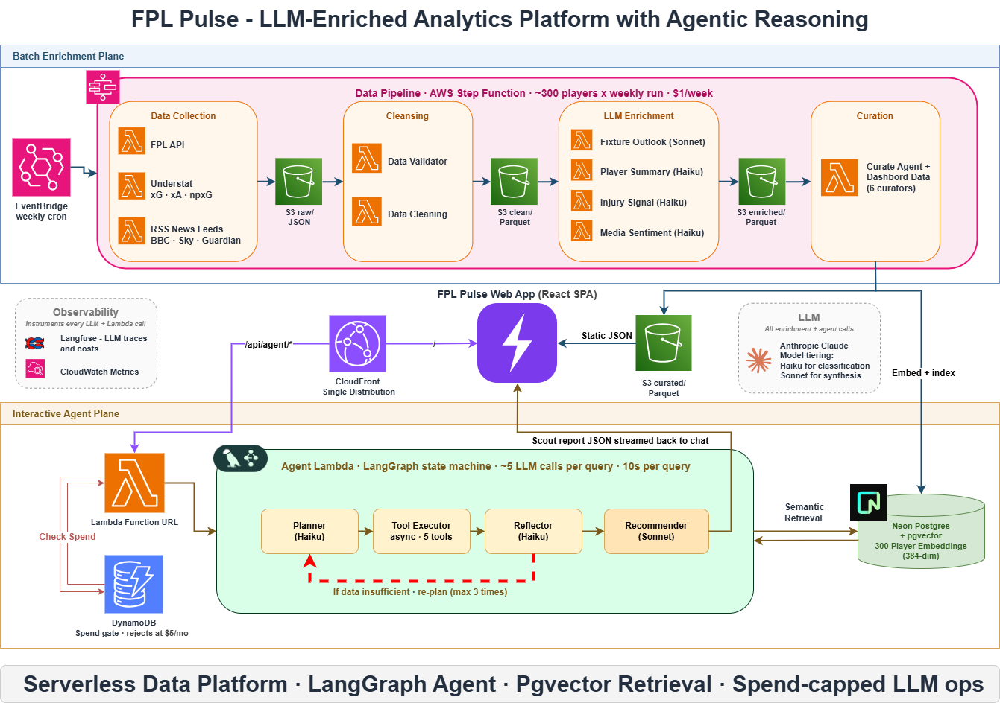

# FPL Pulse

Weekly, LLM-written scouting notes for Fantasy Premier League, and an agent you can ask about transfers.

**[Dashboard](https://fpl.isseikuzuki.co.uk)** · **[Ask the agent](https://fpl.isseikuzuki.co.uk/chat)** · **[Write-up](https://isseikuzuki.co.uk/projects/fpl-pulse/)** · **[ADRs](docs/adr/)**



Every gameweek an EventBridge schedule starts a Step Functions pipeline. Collector Lambdas pull from the FPL API, Understat and a few football RSS feeds into an S3 lake; a validation step promotes clean data to parquet; enrichment Lambdas have Claude write a summary, an injury signal, a media sentiment read and a fixture outlook for the 300 most-owned players; six curators turn all of that into the JSON the dashboard reads. The same curated data is embedded into Neon pgvector for **Scout**, a four-node LangGraph agent (planner, tool executor, reflector, recommender) that streams a reasoned transfer recommendation back to the browser.

I built it to learn agentic AI on something I'd actually use, and to run an LLM workload end to end on my own AWS account, where every pound and every failed run is mine to explain. It is a personal project: one pipeline run a week and a bill of roughly £1.50 to £3.00 a week, about 95% of which is the Anthropic API.

## Decisions worth reading

Eleven ADRs live in [`docs/adr/`](docs/adr/). The ones that changed the shape of the system:

**The Anthropic SDK directly, not LangChain** ([ADR-0003](docs/adr/0003-direct-api-over-langchain.md)). Every enrichment call is a prompt template, a Pydantic output schema, a model choice, a token budget and a retry policy. Orchestration already lives one layer up in Step Functions, so a chain abstraction would have added surface area without removing any work.

**Model tiering as the main cost lever** ([ADR-0004](docs/adr/0004-llm-cost-optimisation.md)). Haiku does the bulk classification and summaries, Sonnet only the passes that need real reasoning. Written up properly in [The cost shape of an LLM-heavy serverless pipeline](https://isseikuzuki.co.uk/writing/cost-engineering-llm-pipeline/).

**LangGraph for the agent, despite choosing otherwise elsewhere** ([ADR-0009](docs/adr/0009-scout-report-agent-architecture.md)). The agent loops: the reflector can send the planner back for another pass, capped at three. That conditional cycle is what a graph runtime is for. The reasoning, and why I picked Pydantic AI for a different project, is in [LangGraph and Pydantic AI, six weeks apart](https://isseikuzuki.co.uk/writing/langgraph-vs-pydantic-ai/).

**A Function URL behind CloudFront with a shared secret, not OAC** ([ADR-0010](docs/adr/0010-agent-http-transport-lambda-function-url.md)). The textbook OAC plus `AWS_IAM` setup rejected every streaming POST, because CloudFront relays the viewer's body hash rather than computing one. The Function URL runs with `auth_type = NONE`, CloudFront injects a secret header, and middleware rejects anything without it. A DynamoDB spend and rate gate sits behind that. The debugging story is in [An evening with OAC, POST, and SigV4](https://isseikuzuki.co.uk/writing/sse-streaming-from-lambda/).

**SSM Parameter Store over Secrets Manager** ([ADR-0011](docs/adr/0011-ssm-parameter-store-over-secrets-manager.md)). I was paying for rotation I never used. Small money, but it was most of the AWS bill.

## How the agent is measured

Scout ships with an eval set rather than "I tried it and it worked": 31 golden cases across 12 categories, from head-to-head comparisons and differential picks to vague prompts, questions about players who don't exist, and prompt injection planted in the question or in the data a tool returns. Each case is graded twice. Deterministic hard checks cover tool routing, required player mentions, output schema and caveat discipline; a Claude Haiku judge scores a per-case rubric from 1 to 5.

The tools read from a parquet snapshot committed under [`services/agent/tests/fixtures/`](services/agent/tests/fixtures/), through a pandas-backed registry that mirrors the production pgvector SQL, so a new gameweek doesn't move the score and only changes to the agent do.

The first baseline passed 24 of 29 hard checks with a mean judge score of 4.36. The failures that mattered were two unknown-player questions where the agent wrote convincing prose around a fabricated player; the judge alone would have passed them. Methodology, results and what isn't measured are in the [baseline write-up](docs/evals/baseline.md).

```bash
export ANTHROPIC_API_KEY=sk-ant-...
python services/agent/scripts/run_evals.py --concurrency 3 --output docs/evals/baseline-v1.1.json
```

A full run takes about six minutes and costs around £1.50.

## Known limitations

Cloudflare blocks requests from some AWS IP ranges. The collectors impersonate Chrome's TLS fingerprint with `curl_cffi` and back off exponentially, which handles most of it, but an IP-level block still fails a run now and then. A CloudWatch alarm fires and I rerun the state machine by hand. The proper fix is a residential proxy, which would cost more per month than the pipeline does, so I haven't added one.

## Repo structure

```
fpl-platform/
├── infrastructure/             # Terraform IaC
│   ├── modules/                # S3, Lambda, ECR, Step Functions, CloudFront
│   └── environments/           # dev / prod tfvars
│
├── libs/fpl_lib/               # Shared Python library
│   ├── clients/                # S3, DynamoDB, API clients
│   ├── core/                   # RunHandler pattern, response models
│   ├── models/                 # Pydantic v2 domain models
│   ├── utils/                  # Helpers
│   └── validators/             # Data validation
│
├── services/
│   ├── data/                   # Collection Lambdas (FPL API, Understat, news)
│   ├── enrich/                 # LLM enrichment Lambdas (summary, injury, sentiment, fixtures)
│   ├── curate/                 # Curators that turn enriched data into dashboard and agent JSON
│   └── agent/                  # Scout: LangGraph agent, tools, evals
│
├── web/
│   └── dashboard/              # React 19 + TypeScript + Tailwind v4
│
├── scripts/                    # Backfill and utility scripts
├── docs/adr/                   # Architecture Decision Records
└── .github/workflows/          # CI and deploy pipelines
```

## Getting started

**Prerequisites:** Python 3.11+, Node 20+, Terraform 1.5+, Make, Git.

```bash
# Clone
git clone https://github.com/ikuzuki/fpl-platform.git
cd fpl-platform

# Python: backend services and shared lib
python -m venv venv
source venv/Scripts/activate   # Windows Git Bash
make install                   # installs libs + services in editable mode

# Dashboard
cd web/dashboard
npm install
npm run dev                    # http://localhost:5173
```

**Environment variables:** copy `.env.example` to `.env` and fill in AWS credentials and API keys. Never commit `.env`.

## Development workflow

```bash
make lint                      # ruff check + mypy
make format                    # ruff fix + ruff format
make test                      # all tests
make test-unit                 # unit tests only
make test-service SERVICE=data # single service

cd web/dashboard
npm run lint                   # eslint
npm run test                   # vitest
npm run build                  # production build
```

Branches are `{type}/{short-description}` (for example `feat/fpl-api-collector`), commits follow [Conventional Commits](https://www.conventionalcommits.org/), and every change goes through a pull request with lint and tests in CI.

## Further reading

- [About page](https://fpl.isseikuzuki.co.uk/about): architecture, tech stack and roadmap
- [FPL Pulse](https://isseikuzuki.co.uk/projects/fpl-pulse/) and [Scout Agent](https://isseikuzuki.co.uk/projects/scout-agent/) on my site
- [`docs/architecture/`](docs/architecture/): system overview, data lake layers, security, agent internals

## License

[MIT](LICENSE)
