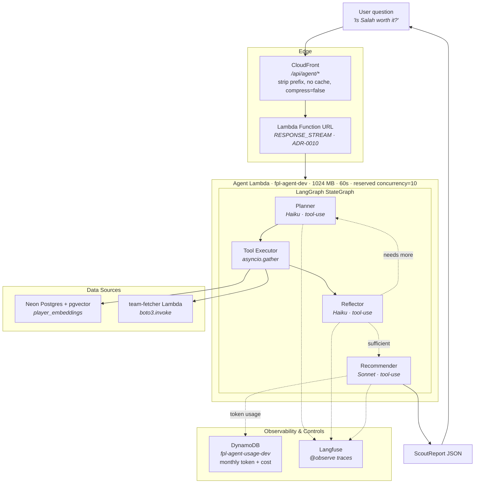
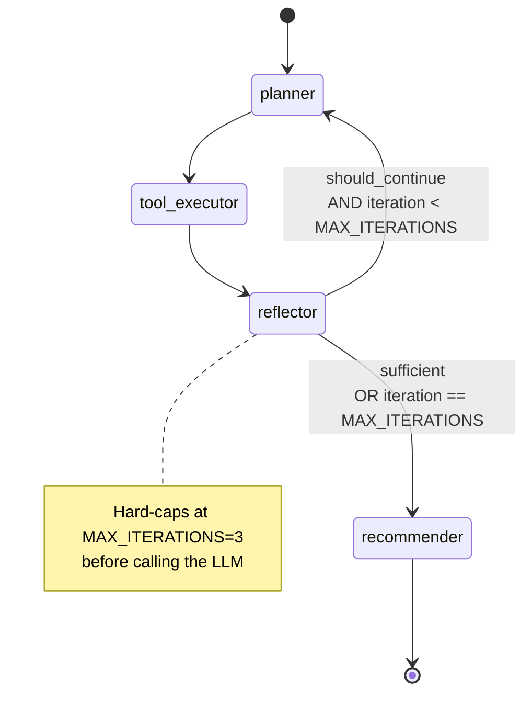

# Scout Report Agent Architecture

The Scout Report agent is a conversational LangGraph state machine that answers natural-language FPL questions ("Is Salah worth the price?", "Compare Palmer and Saka", "Best budget midfielders for the next 5 gameweeks?"). It plans which data to fetch, runs the fetches concurrently, evaluates whether it has enough data, loops if not, and finally synthesises a structured `ScoutReport`.

For the *why* behind agent-vs-chain, node count, model tiering, and public-endpoint cost controls, see [ADR-0009](../adr/0009-scout-report-agent-architecture.md). For a deep walkthrough of the LangGraph mechanics (state, reducers, tool-use structured output, factory closures) see [services/agent/docs/langgraph-walkthrough.md](../../services/agent/docs/langgraph-walkthrough.md).

## Request Flow



## Graph Topology

Four nodes, one conditional edge, three termination paths.



The reflector's conditional edge is the loop-back: it looks at the `should_continue` field set by the Haiku call (or forced to `False` when the iteration cap is hit) and picks either `planner` or `recommender`. [ADR-0009](../adr/0009-scout-report-agent-architecture.md) explains why we chose 4 nodes with a loop instead of a simpler chain.

## Node Responsibilities

| Node | Model | Purpose | Output shape |
|------|-------|---------|--------------|
| Planner | claude-haiku-5-5 | Decide which tools to call this iteration | `list[ToolCall]` via `record_plan` tool-use |
| Tool Executor | — (no LLM) | Dispatch the plan concurrently, capture errors | `dict[tool_name, result_or_error]` |
| Reflector | claude-haiku-5-5 | Decide whether the data is sufficient to answer | `ReflectionResult` via `record_reflection` tool-use |
| Recommender | claude-sonnet-5-5 | Synthesise the gathered data into a structured report | `ScoutReport` via `record_scout_report` tool-use |

Model selection follows [ADR-0004](../adr/0004-llm-cost-optimisation.md)'s principle (match model complexity to task complexity), applied per-node rather than per-enricher. Only the Recommender needs deep cross-source reasoning; the planner and reflector are structured-output decisions that Haiku handles well for 1/10th the cost.

## Tools

Five async tools, dispatched by the executor via `asyncio.gather(..., return_exceptions=True)` so one slow or broken tool does not cancel its siblings.

| Tool | Backing store | Purpose |
|------|---------------|---------|
| `query_player` | Neon | Look up a single player by name (ILIKE) |
| `search_similar_players` | Neon (pgvector) | Cosine-distance neighbours over 384-dim embeddings |
| `query_players_by_criteria` | Neon | Filter by position / price / form / team |
| `get_fixture_outlook` | Neon | Return the stored aggregate fixture-difficulty signal |
| `get_injury_signals` | Neon | Return stored injury-risk + form-trend enrichment |

Squad loading is intentionally **not** in the tool registry. The dashboard calls `GET /team` (which invokes the team-fetcher Lambda + enriches via Neon), receives a `UserSquad`, and echoes it on every chat request. The agent reads it from `state["user_squad"]` and renders it into both the planner and recommender prompts as context. Letting the agent dispatch a cross-service Lambda invoke at planning time would require it to invent a `team_id` it has no source of truth for.

All tools take a `NeonClient` through a factory closure — `make_tools(neon)` returns a dict of callables with the client captured in each scope. State never carries a live connection; see the walkthrough doc for the "why".

Per-tool timeout: `TOOL_TIMEOUT_SECONDS = 10` (Lambda's 60s ceiling minus ~15s of LLM latency leaves ~45s for up to 3 iterations of tool calls; 10s each is generous for a Neon query).

## Structured Output via Tool-Use

Every LLM call uses Anthropic's tool-use API as a structured-output mechanism — not for agentic tool invocation. Each node declares a *fake* tool whose `input_schema` is derived from a Pydantic model:

```python
_SCOUT_REPORT_TOOL = {
    "name": "record_scout_report",
    "description": "Record the final scout report answering the user's question.",
    "input_schema": ScoutReport.model_json_schema(),
}

response = await client.messages.create(
    model=RECOMMENDER_MODEL,
    tools=[_SCOUT_REPORT_TOOL],
    tool_choice={"type": "tool", "name": "record_scout_report"},  # FORCE it
    messages=[...],
)
```

Anthropic's server-side decoder constrains sampling to valid JSON matching the schema. Syntactic failures (markdown fences, missing braces, malformed strings) cannot happen — they would violate the schema at the token-sampling level. Residual semantic failures (e.g. recommender omits a required field due to an Anthropic bug) are caught at the Pydantic layer and short-circuit to `state["error"]`.

Schemas are byte-identical across calls, so **Anthropic prompt caching** stores them at 90% discount after the first call in a 5-min window. Net cost impact: within ±10% of unstructured calls, often cheaper once you account for avoided retries.

## Conversation Memory

A chat request may carry a `conversation_id`, a UUID the dashboard creates per chat and replaces on "New chat". When it does, the API loads that conversation's last 3 turns from `fpl-agent-conversations-{env}` before running the graph, and after a successful report appends the new turn. Each turn is the question, the players discussed, the analysis cut to 600 characters and the recommendation. The turns are rendered oldest-first into an "Earlier in this conversation" block in the planner, reflector and recommender prompts (`prompts/v2/`), capped at 4,000 characters. The prompts use the block only to resolve references such as "his" or "the one you picked", and treat it as context rather than instructions.

Items expire 30 minutes after the last write; reads also ignore expired items, since DynamoDB TTL deletion is lazy. With no `conversation_id`, a new one, or an expired one, the block reads "None" and the agent behaves as a single-turn agent. Store failures fall back to no history. The decision and its trade-offs are in [ADR-0012](../adr/0012-agent-conversation-memory.md).

## Cost Controls

The agent endpoint is publicly accessible — anyone with the CloudFront URL can send questions. Three independent layers bound spend:

| Layer | Where | Configuration | Purpose |
|-------|-------|---------------|---------|
| Lambda reserved concurrency | Terraform (`modules/lambda`) | `reserved_concurrent_executions = 10` | Hardware-level backpressure; replaces API Gateway throttling after ADR-0010 |
| Application rate limiter | `middleware/rate_limit.py` | 5/min + 20/hour per session | Per-session fairness; in-memory per Lambda container |
| Reflector iteration cap | `graph/config.py` | `MAX_ITERATIONS = 3` | Bounds per-request LLM calls at 7 (3 planner + 3 reflector + 1 recommender). Most queries resolve in 2 iterations (5 calls) |
| DynamoDB budget kill-switch | `fpl-agent-usage-dev` | Monthly `$5` cap enforced at request entry | Hard cap on monthly spend. Returns 429 "demo has hit its monthly limit" when exceeded |

No authentication. For a portfolio project, this layered defence + a hard monthly cap is sufficient. Full security posture in [docs/architecture/security-architecture.md](security-architecture.md).

**Per-query cost estimate (ADR-0009 target range):**

| Scenario | Planner | Reflector | Recommender | Approx cost |
|----------|---------|-----------|-------------|-------------|
| Single tool, 1 iteration | 1× Haiku | 1× Haiku | 1× Sonnet | ~$0.03 |
| Typical, 2 iterations | 2× Haiku | 2× Haiku | 1× Sonnet | ~$0.05 |
| Complex, 3 iterations (cap) | 3× Haiku | 2× Haiku* | 1× Sonnet | ~$0.08 |

*Third reflector call is skipped (hard cap short-circuits before calling the LLM).

## Observability

Every node and tool is decorated with Langfuse `@observe()`. The trace hierarchy per request:

```
request (trace)
├── node.planner (span)
│   └── [Anthropic API call]
├── node.tool_executor (span)
│   ├── tool.query_player (span)
│   └── tool.get_fixture_outlook (span)
├── node.reflector (span)
│   └── [Anthropic API call]
└── node.recommender (span)
    └── [Anthropic API call]
```

Each LLM node logs `input_tokens` + `output_tokens` at INFO level for CloudWatch-based cost tracking. The DynamoDB budget writer (PR #93) consumes these logs to keep the `usage[month]` row up to date. Langfuse traces surface the full plan, gathered data, and ScoutReport at each step — non-trivial for debugging "why did the agent say X?".

Runtime Langfuse client init (env vars, session IDs, cost attribution) lands in PR #93. PR #91 only placed the decorators.

On the streamed `POST /chat` path the `agent_chat_request` span is opened inside the SSE generator, not by a decorator on the handler. The handler returns the `EventSourceResponse` before the graph runs, so a span opened there would close first, leaving every node as its own root trace and the trace scores with nothing to attach to.

### Chat latency

Every streamed `/chat` request records four latencies, all in milliseconds from the moment FastAPI starts resolving the request (before the budget and rate-limit checks):

| Metric | What the user sees at that moment |
|---|---|
| `time_to_first_event_ms` | The first step pill ticks. The first SSE event is sent when the planner finishes, so this is mostly one Haiku call plus the budget check. |
| `time_to_first_report_token_ms` | Still the pills. The recommender has produced its first output token, measured by streaming the recommender call internally. |
| `time_to_first_report_text_ms` | The report's analysis starts appearing. The recommender node parses the model's partial JSON as it streams (`jiter`, trailing-strings mode) and emits each new piece of `analysis` through LangGraph's custom stream; the API relays it as `report_delta` SSE events and the dashboard renders it as a draft. |
| `total_ms` | The full report card replaces the draft. Measured when the `result` event is handed to the stream, after the budget and memory writes. |

`analysis` is the first field the model writes: the report schema sent to the model leaves out `question`, which the node fills in, so no output tokens go on echoing the question. In five local runs on Haiku 5.5 + Sonnet 5.5 the analysis text appeared within 0.6 s of the first token, and 3.4–7.9 s before the full report (median 4.7 s, a third of the wait). Before report streaming, on Haiku 4.5 + Sonnet 4.6, the same wait was dominated by generation after the first token: in six local runs p50/p95 were 7.0 s / 9.6 s to the first report token and 23.7 s / 33.9 s in total, with nothing on screen in between. The recommender's own time to first token (from its call starting) is also attached to its generation span as `time_to_first_token_ms`.

Production numbers from ten requests through CloudFront on Haiku 4.5 + Sonnet 4.6, before report streaming (CloudWatch, n=10), were close to the local ones: p50/p95 of 1.2 s / 2.0 s to the first event, 7.0 s / 10.0 s to the first report token, and 25.6 s / 33.2 s in total.

The clock starts when FastAPI handles the request, so a cold start is invisible to all three metrics. In that run the first two requests hit cold containers whose init overran Lambda's 10 s init limit (`INIT_REPORT ... Status: timeout`) and was retried; the first request returned 504 from CloudFront at 30 s while its own `chat_latency` line recorded a 19 s run. Cold starts have to be read from the `INIT_REPORT` lines or measured from the client.

Each request writes the three values twice: as one `chat_latency {json}` INFO log line, and as numeric scores of the same names on the Langfuse trace. Langfuse tracing is switched off on the deployed Lambda (`LANGFUSE_TRACING_ENABLED = "false"`, see ADR-0005), so in production the log line is the source. `python services/agent/scripts/latency_report.py --hours 24` prints p50/p95 from CloudWatch; `--source langfuse` reads the scores instead. `/chat/sync` is not measured.

## Failure Handling

| Failure | Handling |
|---------|----------|
| Planner outputs invalid tool name | Pydantic `Literal[...]` validation fails → `state["error"]` set, graph short-circuits to recommender which returns a minimal error report |
| Tool times out | `asyncio.wait_for` raises `TimeoutError` → recorded in `gathered_data` as `{"error": "timed out"}`, reflector can re-plan |
| Tool raises `ToolError` | Captured by executor's per-tool `try/except` → recorded in `gathered_data`, siblings unaffected |
| Anthropic transient failure | `AsyncAnthropic` retries internally; exhaustion raises and is captured per-node into `state["error"]` |
| Neon connection lost mid-request | Tool raises, executor records error; if recovery impossible, downstream reflector/recommender still run over partial data |
| Monthly budget exceeded | (PR #93) Handler returns 429 before invoking the graph at all |

## Related Components

- **[ADR-0003](../adr/0003-no-langchain.md)** — "no LangChain" policy. LangGraph is the explicit exception; it earns its place because a stateful loop with conditional branching would be more code by hand than it's worth.
- **[ADR-0004](../adr/0004-llm-cost-optimisation.md)** — model-tiering principle applied to nodes.
- **[ADR-0005](../adr/0005-prompt-versioning-and-llm-observability.md)** — `@observe()` + versioned prompt directories; agent follows the same conventions.
- **[ADR-0007](../adr/0007-static-dashboard-architecture.md)** — the agent API coexists with the static dashboard under one CloudFront distribution (path-based routing at `/api/agent/*`).
- **[ADR-0008](../adr/0008-neon-pgvector.md)** — the agent's data retrieval layer.
- **[ADR-0009](../adr/0009-scout-report-agent-architecture.md)** — agent framing, graph shape, model tiering, cost controls.

## Related Files

- `services/agent/src/fpl_agent/graph/builder.py` — graph assembly
- `services/agent/src/fpl_agent/graph/nodes.py` — the 4 node implementations
- `services/agent/src/fpl_agent/graph/config.py` — model IDs, iteration cap, timeout
- `services/agent/src/fpl_agent/graph/prompts/v1/` — versioned prompts
- `services/agent/src/fpl_agent/tools/player_tools.py` — 6 async tools + `make_tools` factory
- `services/agent/src/fpl_agent/models/state.py` — `AgentState` TypedDict, reducers, `ToolCall`
- `services/agent/src/fpl_agent/models/responses.py` — `ScoutReport`, `PlayerAnalysis`, `ComparisonResult`, `ReflectionResult`, `AgentResponse`
- `infrastructure/environments/dev/agent.tf` — Lambda Function URL + DynamoDB + IAM
- `infrastructure/modules/api-gateway/` — HTTP API v2 module with CORS and throttling
